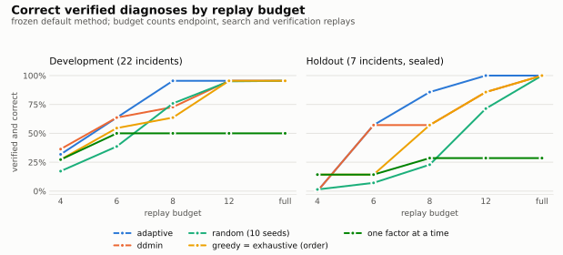

# Regressleuth

**Budgeted counterfactual search over versioned ML pipeline components, including interaction failures, with explicit verification and assumption-violation handling.**

A deploy changed the model, the preprocessing, a config value, the data export and a library version, and accuracy dropped. Which change did it, or which *pair* of changes? Regressleuth replays mixes of the old and new versions on your fixed evaluation cases, picks each next replay to rule out as many explanations as possible, and reports the smallest set of changes that reproduces the regression, with the evidence, the assumptions it checked, and an explicit refusal when the evidence does not support a single answer.

> **Status: `0.1.0a1` (alpha), not yet published.** Install from a clone. Numbers below come from benchmarks in this repository; read [What it does not claim](#what-it-does-not-claim) and [Limitations](#limitations) first.

For a quick technical overview, read the [project case study](docs/CASE_STUDY.md).

## The problem it solves

Testing one change at a time misses interactions:

| model | feature assembler | result |
|---|---|---|
| old | old | pass |
| new | old | pass |
| old | new | pass |
| new | new | **fail** |

With `k` changed components there are `2^k` combinations. On seven author-constructed, sealed validation incidents with five changed components each, adaptive search verified 6/7 causes within eight **isolation** replays. It used 10.3 total replays on average once the historical `full` audit was counted. At the full isolation budget it verified 7/7 with 6.9 isolation replays and 11.1 total replays; the stronger `extended` audit raised total cost to 21.6. These small-suite results are descriptive, not evidence of general superiority.

## What it does not claim

- It is **not** generic causal discovery and gives no causal guarantee: `verified` means **verified under the configured replay model, assumptions, and audit checks** ([VERIFICATION.md](docs/VERIFICATION.md)).
- It is **not** universally optimal root-cause analysis, and replay-based diagnosis is **not new** (see [Related work](#related-work)).
- Its advantage over strong baselines (delta debugging) is **measured only on the incidents in this repository**, most of which the author constructed. At eight isolation replays, adaptive and ddmin differed on only two of seven validation incidents. The method is not yet established as a novel research algorithm.
- For noisy metrics, a diagnosis-level guarantee exists only in the opt-in `interval: anytime` mode with a declared `noise_scale`: there, P(a `verified` set is not a true minimal failing set) <= 1 - `confidence` under stated noise assumptions (proof and pre-registered simulations in [Verification](docs/VERIFICATION.md#diagnosis-level-error-control-interval-anytime)). The default Student-t intervals bound single comparisons only, so noisy results in that mode stop at `inferred`.

## Two-minute quickstart

```bash
# From a checkout of this repository:
pip install -e .            # Python 3.10+; `pip install regressleuth` once released
regressleuth demo           # offline, standard library only
```

```text
Status: VERIFIED
CAUSE: normalizer + tokenizer
Replays: isolation 7/16 + audit 6; full exhaustive search = 16
Verification: audit extended; interval student_t (not applied: deterministic); confidence 0.95; repeats 1/1
```

`regressleuth demo --format html --output report.html` shows the good/bad state, every combination tried, how the candidate causes were eliminated, the effective verification settings, and the assumption checks.

**Free online demo:** [space_static](space_static) contains eight precomputed reports from
two bundled synthetic incidents. It can be hosted as a free Hugging Face Static Space
or on GitHub Pages; no API or paid compute is needed. The browser selects existing
reports and does not execute a new diagnosis. The live [Gradio template](space) runs
locally; [new hosted Gradio Spaces currently require a paid Hugging Face plan](https://huggingface.co/docs/hub/main/spaces-sdks-static).

## Installation

```bash
pip install -e .                 # core: Python + PyYAML
pip install -e ".[demo]"         # scikit-learn examples and the HTTP service demo
pip install -e ".[text-demo]"    # Hugging Face text examples
pip install -e ".[dev]"          # tests, coverage, linters, build tools
```

## Python API

```python
from regressleuth import diagnose

good = {"model": "v4", "preprocessing": "a1b2c3", "config": "old", "data": "2026-09"}
bad = {"model": "v5", "preprocessing": "d4e5f6", "config": "new", "data": "2026-10"}


def run(components):  # each value is the good OR the bad version
    pipeline = build(components)  # your code: load the versions named here
    return accuracy(pipeline, FIXED_CASES)  # same labeled cases every call


report = diagnose(good, bad, run, threshold=0.03, budget=16, audit="extended")
print(report.status, report.root_cause)  # in Jupyter, `report` renders itself
```

Noisy metric? Accept a `seed` argument and pass `repeats=3, max_repeats=24`. A mix that cannot be built? Raise `regressleuth.errors.IncompatibleReplay`. `investigate(incident_or_path, executor=...)` and the adapters in `regressleuth.adapters` give full control.

## CLI workflow

```bash
regressleuth init my_incident              # runnable incident.yaml + runner.py + cases.json
regressleuth validate my_incident/incident.yaml    # every schema problem, with its location
regressleuth inspect  my_incident/incident.yaml    # what would be searched; runs nothing
regressleuth diagnose my_incident/incident.yaml --format json --output result.json
regressleuth report result.json --format html --output report.html
```

If artifact versions are recorded in Git, `regressleuth manifest-diff . GOOD_REF BAD_REF
deploy/artifacts.json` compares two commits without running a replay. Values are hidden
by default; use `--include-values` for a redacted local mapping. See the
[Git manifest guide](docs/GIT_MANIFESTS.md).

Exit codes: `0` verified, `2` not verified (inferred, inconclusive, unresolved, invalid baseline), `3` invalid input, `4` evaluation error, `5` assumption violated. `--diagnostics-dir DIR` keeps each replay's stdout/stderr tails locally.

## `incident.yaml`

```yaml
version: "1.0"
id: risk-api-2026-10-03
good: {model: "risk-model:v1", feature_assembler: fa-1.4, threshold_config: t-0.50}
bad:  {model: "risk-model:v2", feature_assembler: fa-2.0, threshold_config: t-0.45}
metric: {name: accuracy, direction: higher_is_better, regression_threshold: 0.05}
replay: {repeats: 1}                 # raise for noisy metrics; interval: student_t
search: {strategy: adaptive, max_cause_size: 2}
budget: {max_replays: 16, audit: extended}
cases: cases.jsonl
adapter: {type: http, base_url: "${SERVICE_URL}", mode: predict}
```

Full reference: [docs/INCIDENT_SPEC.md](docs/INCIDENT_SPEC.md) (versioned, with a JSON Schema: `regressleuth schema incident`). Adapters: `command` (local program), `python` (in-process function), `http` (running service), `docker` (experimental): [docs/ADAPTERS.md](docs/ADAPTERS.md). Result format: [docs/RESULT_SCHEMA.md](docs/RESULT_SCHEMA.md).

## How the adaptive search works

1. Replay the all-good and all-bad states; if they do not separate, stop (`invalid_baseline` or `inconclusive`).
2. Consider every candidate cause: each changed component and each pair (and each triple with `max_cause_size: 3`).
3. Replay the combination whose outcome splits the remaining candidates most evenly (each result rules out the candidates that predicted the opposite).
4. When one candidate remains, verify it: its own combination fails and every smaller subset passes.
5. Audit the assumption behind the search with extra replays; any contradiction gives `assumption_violated` and no cause is reported.

All six strategies (adaptive, ddmin, random, greedy, exhaustive, one factor at a time) share the same driver, budget accounting, verification and audit, so comparisons are fair. Details: [docs/METHOD.md](docs/METHOD.md).

## Assumptions

Every report lists these with whether they were checked: the same labeled cases are scored in every replay; replays depend only on the declared versions and the seed; one minimal cause of at most `max_cause_size` components; failure is monotone (checked by the audit); noise is captured by the declared repeats; unbuildable mixes are reported as incompatible. [What `verified` means and when it holds](docs/VERIFICATION.md).

## Statuses

`verified` · `inferred` (leading suspect, some checks could not run) · `inconclusive` (noise hid the effect) · `unresolved` (several causes remain) · `invalid_baseline` (no regression on these cases) · `assumption_violated` (no safe single answer) · `evaluation_error` (a replay failed). They are never collapsed.

## Benchmark

| Suite | Incidents | What it is |
|---|---|---|
| development | 22 (20 real models, 11 pairs) | tabular, text (DistilBERT/BERT), image, environment (pandas 2 vs 3), noisy retraining; designed with the method |
| **holdout** | **7** + 1 control | sealed before evaluation; reconstructed from documented behavior (NumPy NEP 50, pandas 3 datetime resolution, pandas `NA` parsing, training-serving skew, `predict_proba` column order, `PYTHONHASHSEED`, time zones) on Adult census, MNIST and synthetic data |
| higher-order | 4 triples + 2 controls | three-way failures on real models; cancelling and healing changes |
| synthetic | 31 + 11 controls | oracle incidents with 5 to 8 components, 8 noisy |
| **external historical pilot** | **9** single-component | public pandas, scikit-learn and Pillow regression reports selected under a protocol frozen before the search; matched environments; sealed and evaluated once |
| dependency-drift study | 40 candidates; **0 eligible** | public reports screened under a pre-registered multi-component protocol; 33 excluded and 7 disputed after controlled replay; sealed and evaluated once |
| noise-guarantee simulations | 151,200 + 43,200 investigations | pre-registered synthetic studies of the `anytime` error bound (v1, v2) |
| large-search-space study | 54,000 investigations | pre-registered synthetic study at 8, 10 and 12 changed components |

The historical method profile was frozen locally (hashes plus a behavioral fingerprint of 1,872 replay sequences) before this suite was built, and the author specified and sealed its construction. These files have no independent timestamp or external author review. The seven holdout incidents were constructed to satisfy the method's monotone single-cause model. Every ground truth is checked by replaying all combinations. Protocol and full tables: [docs/BENCHMARKS.md](docs/BENCHMARKS.md).

## Results: development and holdout, reported separately

Correct verified diagnoses by replay budget (historical frozen `full`/`normal` profile):

<picture>
  <source media="(prefers-color-scheme: dark)" srcset="docs/figures/accuracy_vs_budget_dark.svg">
  
</picture>

| Strategy | Development, B=8 | Development, mean isolation replays at full budget | **Validation, B=8** | **Validation, B=12** | **Validation, mean isolation replays at full budget** |
|---|---:|---:|---:|---:|---:|
| **adaptive** | **95%** | **5.6** | **86% (6/7)** | **100%** | **6.9** |
| ddmin (delta debugging) | 73% | 6.5 | 57% | 86% | 8.3 |
| random (10 seeds) | 76% | 7.0 | 23% | 71% | 10.7 |
| greedy | 64% | 7.0 | 57% | 86% | 9.0 |
| exhaustive | 64% (order) | 12.0 | 57% (order) | 86% (order) | 32.0 |
| one factor at a time | 50% | 5.0 | 29% | 29% | 6.6 |

No strategy verified a wrong cause on the seven model-conforming validation incidents. The original incident bootstrap interval was too narrow for a suite this small; at 6/7, the exact binomial 95% interval is about 42% to 100%, even before accounting for shared datasets and author construction. At B=8, adaptive beat ddmin on two incidents and tied on five (exact paired two-sided p=0.5). That budget-8 result also depends on the arbitrary component-name order used to break ties: over all 120 renamings of each incident, adaptive verified 78.6% and ddmin 50.0% ([sensitivity analysis](docs/experiments/TIE_BREAK_SENSITIVITY.md)). The isolation budget excludes audit replays: adaptive averaged 10.3 total with `full` and 19.4 with `extended`; ddmin averaged 9.1 and 15.9. More figures: [unresolved rate](docs/figures/unresolved_vs_budget_light.svg), [replay cost](docs/figures/replay_cost_light.svg), [interactions](docs/figures/interactions_vs_budget_light.svg).

**Interactions.** Pairs at B=8: adaptive 91% development / 80% holdout, ddmin 45% / 40%, one factor 0% / 0%. Three-way causes are never verified by default (they end `assumption_violated`); with `max_cause_size: 3` all four are verified at the full budget (adaptive 12.5 replays, ddmin 17.8, exhaustive 32).

**Safety controls (negative result reported).** The historical `full` audit has a blind spot: when another change cancels or heals a failure away from the diagnosed cause, it verified a cause in 31 of 60 strategy-by-budget configurations on two real-model controls while its monotone model was false. Random search in each configuration averages ten seeds. The stronger `extended` audit caught these *known* controls, at roughly twice to three times the total replays. It was designed after these failures were observed, so its zero-error result is in-sample and does not prove general safety. User incident files, direct objects, and the Python API now default to `extended`; `full` remains available for reproducing the frozen benchmark.

**Secondary release-safety run, current product defaults (`extended`/`student_t`).** On the same stored observations, adaptive verified 21/22 development incidents and 6/7 holdout incidents at B=8; at B=12 it verified 21/22 and 7/7. Correct verification did not fall on either suite. Mean **total** replays at B=8 rose to 11.0 (development) and 19.4 (holdout), versus 7.9 and 10.3 under the frozen profile. Both non-monotone controls had 0/60 false-verifying strategy-by-budget configurations with the new default. These are post-hoc, in-sample safety results, not a guarantee about untested failure patterns. [Full safe-default rows and all strategies](benchmarks/results/safe_default/EVALUATION.md).

**External historical pilot (third-party regressions, sealed, evaluated once).** A selection protocol was frozen before any candidate was logged. Of 30 public regression reports screened (pandas, scikit-learn, NumPy, Transformers, MLflow, torchvision, one Pillow application issue), 21 failed the predeclared rules (most often no exact known-good state or a duplicate transition). The other 9 reproduced in matched environments, which share Python and every pinned dependency except the studied library: each known-good version passed its predeclared test and each known-bad version failed it, with the failure the issue reported, so none was disputed. Across all six strategies and every budget (675 strategy-budget-seed runs), **0 wrong `verified` diagnoses**; every run verified the correct library with 2 replays. **This validates the end-to-end pipeline on real third-party bugs, not the search.** Every eligible incident had one changed component, so the two replays are the endpoints and there is nothing to search or audit (9/9 correct: exact 95% interval 66–100%). No public report met the rules with two or more independently versioned changed components, so interaction diagnosis still has no external evidence. [Funnel, rows and caveats](docs/BENCHMARKS.md#external-historical-pilot-9-public-regressions-sealed-evaluated-once).

**Dependency-drift study (negative result, sealed and evaluated once).** A separately pre-registered search logged 40 public candidate reports. Thirty-three failed screening; seven reached controlled replay, but all seven were disputed because the declared good state failed or the bad state passed. **Zero incidents were eligible, so there are zero strategy runs and no measured search, interaction, or false-verification rate from this study.** The disputed cases and their failure reasons remain in the sealed ledger. Exclusion reason counts overlap because a candidate may have several reasons. [Protocol and full funnel](docs/BENCHMARKS.md#dependency-drift-study-zero-eligible-incidents).

**Help close the external-evidence gap.** If you have a public regression with pinned good/bad artifacts, a fixed test, and replayable component mixes, use the [external incident guide](docs/EXTERNAL_INCIDENTS.md). Submissions enter a new pre-registered study; they do not change the completed benchmark results.

**Diagnosis-level noise guarantee (proof plus pre-registered simulations).** With `interval: anytime` and a declared `noise_scale`, every replayed combination gets an anytime-valid confidence sequence, and the error budget is split over all `2^k` combinations. A short proof then gives P(wrong `verified`) <= 1 - `confidence` for any strategy, budget, audit setting and stopping rule. It needs independent sub-Gaussian noise of at most the declared scale; monotonicity is not required. Pre-registered simulations found **0 wrong `verified` in 43,200 `anytime` investigations**, including a stress scenario with a cause just above the threshold and a decoy just below it. In that scenario the default Student-t intervals gave **98 wrong `verified` in 3,600** with the `extended` audit, and every Student-t `verified` result there was wrong. The normal interval gave 149. So the default changed: noisy Student-t results now stop at `inferred`. The guarantee costs power: `anytime` uses about 40% more runs and abstains near the threshold. [Details](docs/BENCHMARKS.md#noise-guarantee-simulations-pre-registered-one-run-each).

**Large search spaces (pre-registered, synthetic).** At 8, 10 and 12 changed components (up to 4,096 combinations), 54,000 investigations gave 0 wrong `verified`, including a non-monotone control. The engine takes 0.37 s and under 3 MB per adaptive investigation at 12 components. For **pair** causes at 12 components and 16 isolation replays, adaptive verified 100%, ddmin 41%, exhaustive 1% and one-factor 0%. For **single** causes, ddmin needed fewer replays than adaptive (p < 1e-6). The `extended` audit is the dominant cost at this size, about 131 replays for a single cause. These incidents satisfy the method's model by construction. [Details](docs/BENCHMARKS.md#large-search-space-study-pre-registered-synthetic).

## Practical example: a regressed HTTP service

[`examples/http_service`](examples/http_service) runs a known-good and a regressed release of a scikit-learn scoring service locally, then diagnoses the regression purely through HTTP (version pinning by header, as canary routers do):

```bash
python examples/http_service/prepare.py && python examples/http_service/run_demo.py
```

Recorded result: 5 changed components, 15 candidate causes, full search 32 replays; **`feature_assembler + model` verified under the configured replay model, assumptions, and extended audit checks** after 8 isolation + 13 audit replays, 1.6 s.

## Environment and library versions

A library upgrade is a component like any other: map an `environment` component to interpreters (virtualenvs) and `{python}` becomes the selected one. Real examples in this repository: pandas 2.3 vs 3.0 (chained assignment silently stops working; datetime parsing changes resolution) and NumPy 1.26 vs 2.x (scalar promotion). **Docker:** the `docker` adapter exists but is experimental: Docker was not available where this release was built, so it is tested only against a fake `docker` executable and has not been validated against a real daemon. No Docker demo is claimed.

## Limitations

- The sealed validation suite has 7 incidents reconstructed by the same author, all selected to satisfy the search model. It is not an independent set of production incidents.
- The external historical pilot uses third-party reports but contains only single-component incidents, so it cannot show a search or interaction advantage; it was screened and built by the same author.
- The pre-registered dependency-drift study yielded no eligible incidents after screening and controlled replay. Its empty evaluation supplies no external multi-component performance evidence.
- Real incidents have 3 to 5 changed components, where exhaustive search is affordable; the efficiency gap over ddmin is modest there (6.9 vs 8.3 replays on the holdout) and largest at tight budgets. For a **single** cause, delta debugging is slightly cheaper than adaptive search (synthetic study, 8 to 12 components); adaptive search pays off for interacting pairs.
- At 10 to 12 components the default `extended` audit dominates cost: about 90 to 130 audit replays on top of 7 to 11 isolation replays in the synthetic study.
- `verified` is relative to the replays run and declared assumptions. Even the new default `extended` audit can miss untested non-monotone combinations. Causes larger than three components are not searched.
- The historical benchmark used a normal interval, which is too narrow with very few repeats. With the default `student_t`, noisy results stop at `inferred`; `verified` for noisy metrics needs `interval: anytime` and an honest `noise_scale`, and it costs more runs and abstains near the threshold.
- Replays must be reproducible from the declared versions and seed, on fixed cases. Coupled changes (a model that needs its new preprocessing) are refused as `invalid_baseline`, not explained.
- The replay command runs your code without a sandbox; only use trusted code ([SECURITY.md](SECURITY.md)).

## Reproducibility

```bash
pip install -e ".[demo,dev]"
pytest --cov=regressleuth                       # 172 tests with demo extra, about 95% coverage
python benchmarks/freeze_method.py verify       # historical behavioral trace unchanged
python benchmarks/seal.py verify benchmarks/holdout
python benchmarks/reproduce_frozen.py --output /tmp/regressleuth-frozen-reproduction
python benchmarks/evaluate_safe_default.py     # separate secondary release-safety run
python benchmarks/historical/verify_snapshot.py # external historical pilot: seal and results, from the frozen source
python benchmarks/drift/harness.py verify       # dependency-drift study: sealed ledger and method freeze
regressleuth bench                              # synthetic suite
```

Rebuilding the replay tables from scratch (models, data, interpreters) is described in [docs/BENCHMARKS.md](docs/BENCHMARKS.md#reproduce).

## Related work

Closest prior work: [CULPA](https://github.com/laiba-mazhar/culpa-pipeline-attribution/blob/main/PAPER.md) (hybrid replay for ETL fault attribution), [Maro](https://arxiv.org/abs/2205.01311) (diagnosing failing ML pipelines), [delta debugging](https://www.st.cs.uni-saarland.de/papers/tse2002/) (the `ddmin` baseline), counterfactual replay for LLM agents, and `git bisect` for ordered commits. The contribution here is the narrow combination above, measured against those baselines on reproducible, provenance-documented incidents.

## Citation

See [CITATION.cff](CITATION.cff) (Avdhesh Mishra, 2026). Tutorial: [docs/TUTORIAL.md](docs/TUTORIAL.md). Changelog: [CHANGELOG.md](CHANGELOG.md). Contributing: [CONTRIBUTING.md](CONTRIBUTING.md).

## License

Apache-2.0 ([LICENSE](LICENSE)).
