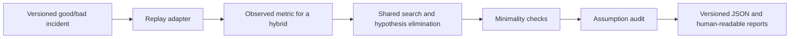

# Regressleuth: an ML regression debugging case study

**Project:** Python CLI and library for finding which versioned ML pipeline changes
reproduce a measured regression. **State:** `0.1.0a1` alpha source on GitHub;
no package-index release. **Live computation:** local installation. **Free web demo:**
[precomputed replay explorer](../space_static/README.md).

## The engineering problem

An ML release can change a model, feature assembler, data export, configuration,
and library environment together. A metric regression may need two changes to
interact: testing each change alone then misses the failure. Testing every mix
needs `2^k` replays for `k` changed components, which becomes expensive when a
replay loads a model or scores a fixed evaluation set.

Regressleuth accepts known-good and known-bad versions for each component, one
fixed case set, a metric threshold, and a replay function or adapter. It tests
hybrid versions, eliminates candidate single and pair causes, then verifies a
minimal cause and audits the assumption behind the search. A report includes the
complete replay sequence, effective verification settings, checked assumptions,
and reasons for withholding a diagnosis.



The adapters cover local commands, Python callables, and HTTP services. The
Docker adapter is experimental and has not been checked against a real daemon.
The search driver shares replay caching, budget accounting, and verification
across six strategies, including adaptive search and delta debugging. See the
[method](METHOD.md) and [adapter contract](ADAPTERS.md).

## What was measured

The table below separates the preserved research configuration from the later
product default. Budget `B=8` counts **isolation** replays; audit replays add to
the actual cost. The default-safety run reused the same stored observations and
was done after a safety weakness was discovered.

| Evaluation | Development | Holdout | Safety controls |
|---|---:|---:|---:|
| Historical frozen profile, adaptive, `B=8` | 21/22 correctly verified | 6/7 correctly verified | 31/60 false-verifying strategy-by-budget configurations on two known non-monotone controls across all strategies |
| Current `extended`/Student-t default, adaptive, `B=8` | 21/22 correctly verified; 11.0 mean total replays | 6/7 correctly verified; 19.4 mean total replays | 0/60 false-verifying configurations on those same controls |

The frozen profile's adaptive mean total replays at `B=8` were 7.9 on development
and 10.3 on holdout. The safer audit costs more replays. The 0/60 result is a
regression check on two *known* controls, not an estimate of field safety: the
`extended` audit was designed after seeing them. On the seven-case holdout,
adaptive and delta debugging differed on two incidents at `B=8`, and that
comparison is too small to establish general superiority. The holdout was sealed
but still constructed by the project author. Full rows and methods are in the
[benchmark report](BENCHMARKS.md).

An external historical pilot reproduced nine public bugs in matched environments.
Every eligible bug changed only one component, so this validates the replay path
but offers no external evidence for multi-component search or interactions. Two
separate pre-registered dependency-drift studies, one from issue reports and one from
failing lockfile-update pull requests, screened 80 public candidates and found zero
eligible incidents. Their [negative results](BENCHMARKS.md#dependency-drift-study-zero-eligible-incidents)
are reported without a performance claim.

## A practical entry point: dependency upgrades

`regressleuth init --from-lockfiles good.lock bad.lock --test NODE` turns a broken
dependency update into an incident. Each changed distribution becomes a component, and
each replay installs one mix of old and new pins with uv and runs the failing test. In the
bundled real example, pandas 2.3.3 → 3.0.0 among five changed distributions is
`verified` as pandas in 8 replays.

## Safety and verification

The original `full` audit sometimes returned `verified` when another change
healed or canceled a failure. The product defaults to `extended`, which
checks additional combinations and withholds a cause when it observes a model
contradiction. Noisy metrics use Student-t intervals by default, but a result
judged with these per-comparison intervals stops at `inferred`. The opt-in
`anytime` interval can return `verified` under its declared sub-Gaussian noise
assumptions and diagnosis-level error bound.

`verified` always means **verified under the configured replay model,
assumptions, and audit checks**. It is not unrestricted causal proof. The
[verification guide](VERIFICATION.md) states exactly what was checked and what
could remain hidden among untested combinations.

## Reproduce and inspect

From a checkout with Python 3.10+:

```bash
pip install -e ".[demo,dev]"
regressleuth demo --format html --output report.html
pytest --cov=regressleuth
python benchmarks/freeze_method.py verify
python benchmarks/seal.py verify benchmarks/holdout --definitions-only
python benchmarks/evaluate_safe_default.py
```

The package currently passes over 210 tests at about 93% coverage, strict type checking,
lint and format checks, build, Twine checks, and wheel/sdist content auditing.
The [static explorer](../space_static/README.md) shows actual reports from bundled
synthetic oracle incidents without a paid API or server. Its snapshots are not
new online investigations.

## Remaining research work

The strongest missing evidence is an independently curated, sealed set of real
regressions with two or more changed components and feasible hybrid replays. A
future evaluation should compare methods at equal **total** replay cost and
include independent non-monotone and noisy controls. The [roadmap](ROADMAP.md)
keeps these as explicit gates before a stable release or broad research claim.
